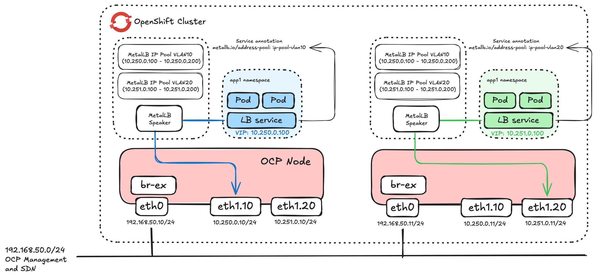

# MetalLB layer2 with vlans

In this example, MetalLB is configured in layer2 mode with separate VLANs / address pools configured.



This assumes you have deployed the MetalLB operator and an instance of MetalLB.

## Enable global forwarding

In order to use VLANs for MetalLB, you must configured forwarding:


```
oc patch network.operator cluster -p '{"spec":{"defaultNetwork":{"ovnKubernetesConfig":{"gatewayConfig":{"ipForwarding": "Global"}}}}}' --type=merge
```

Or edit network.operator.openshift/cluster:

```
oc edit network.operator.openshift/cluster
``` 

and add ipForwarding to the spec as per below:

```
spec:
    defaultNetwork:
      ovnKubernetesConfig:
        gatewayConfig:
          ipForwarding: Global
```


## Configure VLAN interfaces on the hosts

Install NMstate operator and create an instance of nmstate CR. The example nodenetworkconfiguration policy creates VLAN interfaces on each of the hosts that will run MetalLB speak pods. 

```
oc apply -f nncp-host-vlans.yaml
```

## MetalLB Address Pools and layer2 advertisements

Create an **IPAddressPool** CRD for each of the VLANs. Examples in ip-addresspool-vlan10.yaml and ip-addresspool-vlan20.yaml.

```
oc apply -f ip-addresspool-vlan10.yaml
oc apply -f ip-addresspool-vlan20.yaml
```

Create **L2Advertisement** CRD for each VLAN. Examples in l2-advertisement-vlan10.yaml and l2-advertisement-vlan20.yaml

```
oc apply -f l2-advertisement-vlan10.yaml
oc apply -f l2-advertisement-vlan20.yaml
```

## Test the deployment

When creating a LoadBalancer service with MetalLB, you can add annotations to request specific IP addresses or address from a specific IP Pool. In this example we will request a specific pool with this annotation on the Service config:

```
  annotations:
    metallb.io/address-pool: ip-addresspool-vlan20
```

Deploy app1 which will use vlan10 for loadbalancing:


```
oc new-project app1
oc create deployment app1 --image registry.redhat.io/rhel8/httpd-24:latest
oc apply -f expose-app1-vlan10.yaml
```


Deploy app2 which will use vlan10 for loadbalancing:


```
oc new-project app2
oc create deployment app2 --image registry.redhat.io/rhel8/httpd-24:latest
oc apply -f expose-app2-vlan20.yaml
```

Check the services. You should see addresses from the relevant pools as the EXTERNAL-IP:

Here is app1 with an IP on vlan10:

```
oc get svc -n app1
NAME           TYPE           CLUSTER-IP      EXTERNAL-IP    PORT(S)        AGE
app1-service   LoadBalancer   172.32.248.80   10.250.0.100   80:30800/TCP   2m41s
```

And app2 with an IP on vlan20:


```
oc get svc -n app2
NAME           TYPE           CLUSTER-IP       EXTERNAL-IP    PORT(S)        AGE
app2-service   LoadBalancer   172.32.123.221   10.251.0.100   80:31370/TCP   6s
```

Test connectivity to the apps on the LB address:

```
curl -s http://10.250.0.100 | grep title
		<title>Test Page for the HTTP Server on Red Hat Enterprise Linux</title>

curl -s http://10.251.0.100 | grep title
		<title>Test Page for the HTTP Server on Red Hat Enterprise Linux</title>
```
