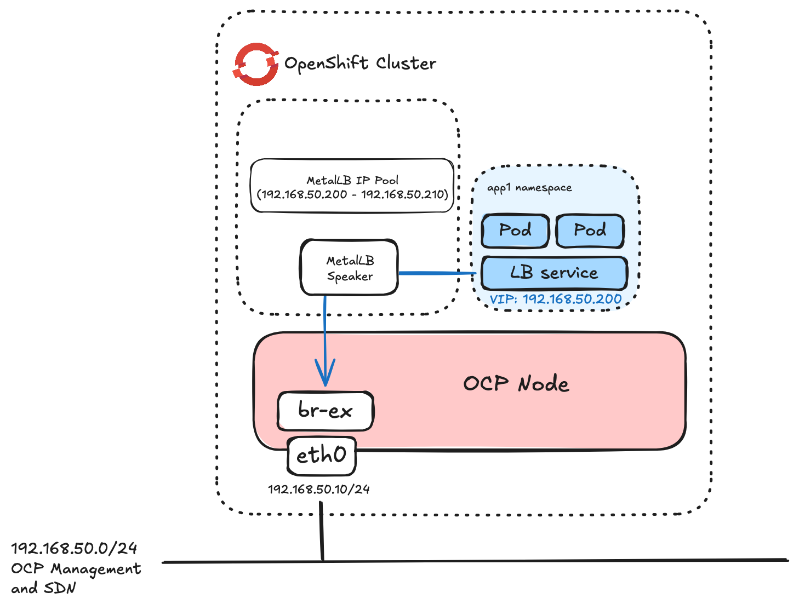

# MetalLB layer2 on machine net

In this example, MetalLB is configured in layer2 sharing the same address space as the machine network



This assumes you have deployed the MetalLB operator and an instance of MetalLB.

## MetalLB Address Pools and layer2 advertisements

Create an **IPAddressPool** CRD with a range of IPs to use for MetalLB. Example config is **ip-addresspool.yaml**

```
oc apply -f ip-addresspool.yaml
```

Create **L2Advertisement** CRD. Example in **l2-advertisement.yaml**

```
oc apply -f l2-advertisement.yaml
```

## Test the deployment

When creating a LoadBalancer service with MetalLB, you can add annotations to request specific IP addresses or address from a specific IP Pool. In this example we just ask MetalLB to choose as we only have a single pool.

Deploy app1 and expose via MetalLB:


```
oc new-project app1
oc create deployment app1 --image registry.redhat.io/rhel8/httpd-24:latest
oc apply -f expose-app1.yaml
```

Check the services. You should see addresses from the relevant pools as the EXTERNAL-IP:

Here is app1 with an IP on the same network as the OCP hosts:

```
oc get svc -n app1
NAME           TYPE           CLUSTER-IP       EXTERNAL-IP      PORT(S)        AGE
app1-service   LoadBalancer   172.32.197.252   192.168.50.200   80:30740/TCP   2s
```

Test connectivity to the apps on the LB address:

```
curl -s http://192.168.50.200 | grep title
		<title>Test Page for the HTTP Server on Red Hat Enterprise Linux</title>
```
