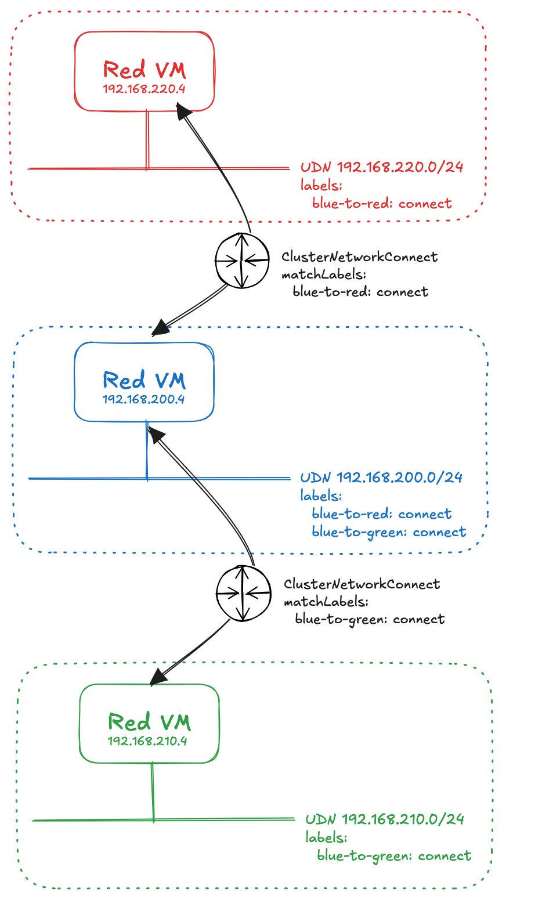

# Connecting User Defined Networks

This repo contains some examples for configure UDN connected networks with the **ClusterNetworkConnect** CRD.

In this example we have three namespaces with primary user defined networks:

* Red tenant should be able to talk to blue, but not green.
* Green tenant should be able to talk to blue, but not red.
* Blue tenant should be able to talk to both green and red.



## Configure cluster connect feature gate in OCP 4.22

As the feature is dev preview in OCP 4.22, you need to enable the featuregate. This puts your cluster into a state where it can no longer be ugraded so only use this for sandbox environments.

Edit the featuregates:

```
oc edit featuregate cluster
```

Add the following spec:

```
spec:
  customNoUpgrade:
    enabled:
    - NetworkConnect
  featureSet: CustomNoUpgrade
```

New configs will rollout to the nodes in the cluster which you can track via the MachineConfigPool.

## Configure UDN

Deploy the three namespaces in this example:


```
oc apply -f namespaces.yaml
```

Deploy the primary UDNs. You can tweak the network addresses as needed:

```
oc apply -f udns.yaml
```

## Deploy VMs

Deploy a VM into each namespace. Make sure the network interface binding is L2 bridge so that the VMs pick up the IP address of the UDN without masquerading.

Test connectivity between VMs at this point. You shouldn't be able to open connections between the VMs.

## Deploy network connects

Deploy the **ClusterNetworkConnect** CRs to allow communications between the various tenants:

```
oc apply -f cluster-network-connect.yaml
```

## Test connectivity

Based on this example configuration, you should now be able to perform simple ping tests to confirm the correct routes are in place:


* Red VM should be able to ping blue VM, but not ping green VM.
* Green VM should be able to ping blue VM, but not red VM.
* Blue VM should be able to ping both red and green VMs.
