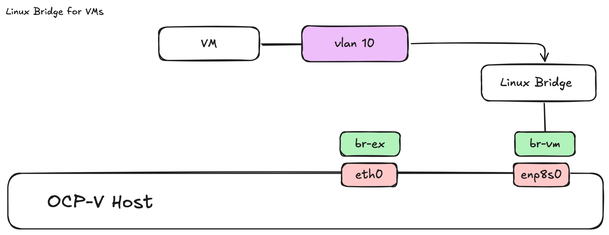

Linux Bridge with vlans
=========

In this example we use a dedicated nic which is configured as a trunk port and has a couple of vlans. We create a linux bridge called br-vm with a single interface enp8s0.

